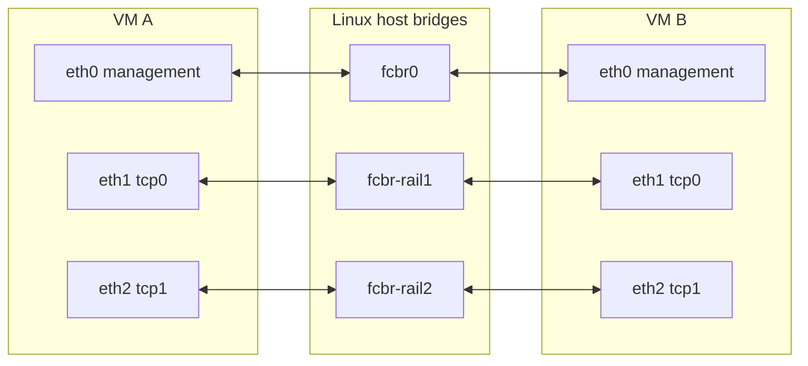

# Linux multi-rail labs

Use an explicit network topology to give each VM two to eight data NICs.
The management NIC, `eth0`, stays on `fcbr0` and is excluded from LNet.
Each data NIC gets its own IPv4 and IPv6 address.
LNet calls each configured data interface a network interface (NI).

Two profiles cover different LNet layouts:

| Profile | Host data network | Default LNet configuration with two TCP NICs |
|---|---|---|
| `shared` | One bridge and subnet for all data NICs | `tcp0(eth1,eth2)` |
| `isolated` | One bridge and subnet per data NIC | `tcp0(eth1),tcp1(eth2)` |

Both layouts support LNet Multi-Rail. Separate `tcp0` and `tcp1` networks
can carry traffic at the same time when both peers attach to both networks.
They do not require LNet routers. Use matching network IDs on both peers.
LNet discovery must group the remote NIDs into one Multi-Rail peer.
See the [Lustre manual](https://doc.lustre.org/lustre_manual.pdf) and
[Whamcloud Multi-Rail overview](https://wiki.whamcloud.com/display/LNet/Multi-Rail%2BOverview).

This diagram shows two VMs on the `isolated` profile:



The data bridges have no connection to each other. In `shared` mode, both
data NICs attach to `fcbr-data` and join one LNet network. Every source NIC
can reach every remote data NIC on that shared subnet. Giving disconnected
fabrics the same LNet ID would allow LNet to select an unreachable pair.

## Prepare the host and image

On a new Linux host, install ltvm as described in
[Getting started](GETTING_STARTED.md). When updating an existing host, run
these steps from the updated checkout:

```bash
uv sync
sudo ./ltvm install --network --install
./ltvm build image rocky9
```

`install --network` prepares the management network and nine managed data
bridges. It installs `ltvm-rail-bridges.service` to restore the data bridges
after a reboot. `--install` also updates the QEMU bridge-helper allowlist
used by unprivileged VMs. An administrator's deny rules are preserved.

The image must contain the current guest routing and LNet setup helpers.
Each supported image has a matching `<image>.rail-topology` sidecar.
Build, package, and fetch preserve this file for that exact image, including
older images retained after a rebuild. Creation and restart reject a missing
or invalid sidecar. Directory metadata alone cannot declare image support.
Rebuild or fetch an image with matching support. Custom `--image` inputs need
their matching sidecar. When selecting a non-default kernel, use the same
`--kernel` value when building the image and creating the VM.

## Create VMs or a cluster

The new options have the same meaning on `create`, `vm create`, and
`cluster create`:

| Short form | Long form | Meaning |
|---|---|---|
| `-T shared` | `--network-topology shared` | Put all data NICs on one fabric and one LNet network. |
| `-T isolated` | `--network-topology isolated` | Give each data NIC a separate fabric and LNet network. |
| `-L NET` | `--lnet-network NET` | Set one data NIC's LNet ID. Repeat in `--nic` order. |

The topology is opt-in. Omitting `-T` keeps the existing NIC behavior.
`-L` requires `-T`. If any `-L` is supplied, supply exactly one per extra
NIC. IDs must match the transport: `tcp0` through `tcp65535` for TCP, or
`o2ib0` through `o2ib65535` for SoftRoCE. Leading zeroes, such as `tcp01`,
are rejected. LNet may print the zero network as `@tcp` or `@o2ib` in NIDs.

Create a VM with two TCP NIs on the shared fabric:

```bash
./ltvm create co1-shared rocky9 --nic tcp --nic tcp \
    --network-topology shared
```

This produces `tcp0(eth1,eth2)`. Source policy routing keeps traffic from
each address on its assigned NIC even though both NICs share a subnet.

Create two isolated rails with explicit network IDs using the short forms:

```bash
./ltvm create co1-isolated rocky9 --nic tcp --nic tcp \
    -T isolated -L tcp7 -L tcp8
```

This produces `tcp7(eth1),tcp8(eth2)`. Without `-L`, the defaults are
`tcp0(eth1),tcp1(eth2)`. A shared profile with custom IDs repeats the same
ID, for example `-T shared -L tcp7 -L tcp7`.

For a cluster, the NIC list and topology apply to every node:

```bash
sudo ./ltvm cluster create co1-mr rocky9 \
    mgs+mds:co1-mds:1 oss:co1-oss:1 client:co1-cli \
    --nic tcp --nic tcp --network-topology isolated
./ltvm cluster deploy co1-mr --build ~/lustre-release --ip-family ipv4 --mount
```

Use `sudo` for cluster creation when the host requires it; `ltvm doctor`
reports whether unprivileged VMs are ready. Inspect the generated setup
before mounting if the Lustre build has its own LNet policy:

```bash
./ltvm vm exec co1-mds 'cat /etc/modprobe.d/lnet.conf'
./ltvm vm exec co1-mds 'modprobe lnet; lnetctl lnet configure --all; lnetctl net show'
```

For SoftRoCE, replace both `--nic tcp` options with `--nic softroce`.
Shared mode produces `o2ib0(eth1,eth2)`; isolated mode produces
`o2ib0(eth1),o2ib1(eth2)`. See [SoftRoCE setup](SOFTROCE_SETUP.md) for RXE
requirements. Shared mode requires one transport. Isolated mode also
allows TCP and SoftRoCE together; default network numbers follow NIC
position, so `--nic tcp --nic softroce -T isolated` uses `tcp0` and `o2ib1`.

## Fixed fabrics and ownership

Explicit profiles use these fixed prefixes:

| Fabric | Bridge | IPv4 | IPv6 |
|---|---|---|---|
| Shared | `fcbr-data` | `172.18.100.0/24` | `fd17:2016:2000:1000::/64` |
| Isolated rail 1 | `fcbr-rail1` | `172.18.101.0/24` | `fd17:2016:2000:1001::/64` |
| Isolated rail 2 | `fcbr-rail2` | `172.18.102.0/24` | `fd17:2016:2000:1002::/64` |
| Isolated rail 3 through 8 | `fcbr-rail3` through `fcbr-rail8` | `172.18.103.0/24` through `172.18.108.0/24` | `fd17:2016:2000:1003::/64` through `fd17:2016:2000:1008::/64` |

Reserve these bridge names and prefixes for ltvm. Check for conflicts with
existing host, VPN, container, and guest networks before installation.
Profile prefixes cannot be changed through the legacy extra-subnet
settings. Creation rejects a management subnet that overlaps a selected
data subnet. It does not detect every conflict elsewhere in the host's
routing setup.

Data bridges are unnumbered: they have no host addresses, DHCP, NAT, or
host routes. Disabling host IPv6 on a data bridge prevents a host
link-local address; the bridge still forwards IPv6 frames between guests.
Installation refuses an existing device with a reserved name unless it is
an ltvm-owned bridge. It also refuses host addresses on a managed data
bridge. Removal refuses bridges that still have attached ports.

Installation sets data bridge MTUs to 4200 bytes for the existing SoftRoCE
guest configuration. Data TAPs inherit their bridge MTU before attachment;
TCP guests can keep their 1500-byte NIC MTU. Startup refuses a data bridge
below 4200 bytes. After upgrading an older installation, rerun
`ltvm install --network` and restart profile VMs to replace old data TAPs.

The resolved topology and guest addresses are saved with the VM. Stop and
start preserve them. Topology, transport, and LNet ID changes require
destroying and recreating the VM. There is no live reconfiguration or
automatic migration of an existing VM to a profile. PCI passthrough NICs
cannot use these managed profiles. Explicit profiles require a Linux host
and two to eight extra TCP or SoftRoCE NICs.

The complete profile kernel command line is limited to 2,047 UTF-8 bytes.
The separate `--kernel-args` limit is 1,024 characters. With eight rails,
long names, and custom network IDs, fewer user arguments may fit. Startup
rejects an oversized command line before changing TAP interfaces.

Deploying Lustre staging preserves a profile VM's generated
`/etc/modprobe.d/lnet.conf`; staging defaults cannot replace its rail grouping.

Cluster server failover is not supported with network profiles. This
includes `cluster create --failover`, `cluster failover`, and
`cluster failback`. Data-rail failure and recovery remain part of the
profile's use. An upstream test that derives NIDs from `hostname -I`
must account for each interface's LNet ID; it must not assign every host
address to one LNet network.

## Guest routing and LNet behavior

Each data source address has its own Linux routing rule and table. The
table contains a connected route through that NIC and a `prohibit`
default route. A second source rule prohibits falling through to other
tables if the lookup cannot use the data path. A failed data NIC must not
send its traffic through the management NIC or another isolated fabric.

The guest helper reserves routing tables `201..208` and rule priorities
`12002..12017` in both families. It rejects foreign rules and routes in
these reserved locations. Repeating setup accepts only matching owned
state. IPv4 setup disables reverse-path filtering and sets `arp_ignore=1`
and `arp_announce=2` for the data NICs and the `all` and `default` scopes.
These settings keep ARP replies and source addresses tied to the intended
NIC. IPv6 data addresses are static; router advertisements and address
autoconfiguration are disabled on those NICs.

On the host, `pyroute2` uses Linux's rtnetlink API for managed data bridges
and root-run profile TAP setup and removal. Host checks read sysfs and the
network API. The minimal guest boot environment uses Bash and has no
rtnetlink library, so the guest helper uses `iproute2` for addresses,
routes, and rules. It writes required kernel settings directly through
`/proc/sys` and checks errors.

LNet peer discovery and health policy determine how available NIs are
used. With healthy peers, suitable policy, and enough work, both rails
should carry payloads. A ping, two listed NIs, or a few health packets do
not prove load distribution. Check peer grouping, source routes, and
substantial data traffic on both endpoints. Failure and recovery times
depend on the Lustre build's health and retry settings. Multiple virtual
rails share host resources, so they do not imply twice the bandwidth or
independent physical failure domains.

## IPv6

Both profiles configure IPv4 and IPv6 source routing. TCP LNet can select
IPv6 with `cluster deploy --ip-family ipv6`; the management NIC remains
IPv4-only. The profile uses the prefixes above and preserves the full
39-character address encoding described in [IPv6 on ltvm clusters](IPV6.md).
The IPv6 cluster deployment path requires TCP as the first LNet network.

LNet IPv6 reachability, Lustre filesystem mounts, and `lst` support are
separate requirements. Some Lustre builds reject long IPv6 NIDs at mount
with the LU-18041 UUID length error. Some `lst` builds reject IPv6 NIDs
because their self-test interface uses the older 64-bit NID format.
Neither limitation makes an IPv4 payload test proof of IPv6 behavior.
The [IPv6 guide](IPV6.md#upstream-ipv6-limits) describes these limits.

## Reproduce the tests

Run the focused tests from this checkout without creating VMs:

```bash
uv run pytest --no-cov \
    tests/test_rail_topology.py tests/test_rail_state.py \
    tests/test_rail_cli.py tests/test_rail_qemu.py tests/test_rail_host.py \
    tests/test_guest_rail_routing.py tests/test_multirail_metrics.py \
    tests/test_multirail_live_guards.py tests/test_multirail_lifecycle.py \
    tests/test_multirail_transport.py tests/test_multirail_selftest.py
make test-sh
```

The live suite requires Linux root access, working KVM, QEMU, `qemu-img`,
`ssh`, `sshpass`, and `ip`, prepared bridges, and a current server-capable
image with matching kernel and Lustre modules. Install the Python test
dependencies with `uv sync`. Prepare artifacts before running the suite;
it does not download or build them. The default target is `rocky9`.

```bash
sudo env LTVM_REQUIRE_MULTIRAIL_E2E=1 \
    .venv/bin/python -m pytest --no-cov -v -rxXs \
    tests/test_e2e/test_08_multirail.py
```

Set `LTVM_MULTIRAIL_TARGET` to select another server-capable target and
`LTVM_MULTIRAIL_KERNEL` to select a kernel artifact directory name.
`LTVM_MULTIRAIL_TRANSPORT` selects `tcp` (the default) or `softroce`.
`LTVM_QEMU_PREFIX`, `LTVM_ARTIFACTS_DIR`, and `LTVM_VM_DIR` use their normal
ltvm meanings. Pass overrides explicitly through `sudo env` when needed.

Run both SoftRoCE profiles over IPv4 with:

```bash
sudo env LTVM_REQUIRE_MULTIRAIL_E2E=1 LTVM_MULTIRAIL_TRANSPORT=softroce \
    .venv/bin/python -m pytest --no-cov -v -rxXs \
    tests/test_e2e/test_08_multirail.py -k ipv4
```

The image needs the RXE and o2iblnd modules and boot helpers described in
[SoftRoCE setup](SOFTROCE_SETUP.md). This invocation selects IPv4 on purpose;
it does not establish IPv6 SoftRoCE support in the selected Lustre build.
The TCP invocation exercises both IP families.

Each test creates two uniquely named VMs with two selected data NICs, 4 GiB
RAM and two vCPUs each. Only the new server's two 2 GiB data disks are
formatted. Cleanup restores data links and destroys the case's own VMs.
Tests use fresh guests so a failed fault test cannot affect a later self-test.
The suite runs shared and isolated profiles over IPv4 and IPv6. It checks
actual bridge membership, source-bound paths, ARP or NDP, LNet peer
discovery, checked filesystem writes and reads, and per-NI traffic. Before
payload tests, it stops and starts one VM, requires unchanged saved
addresses and topology, checks fresh TAPs on the correct bridges, and
reconfigures LNet, and makes the fresh client discover the peer first.
Both directions are checked again. It also tests failure and recovery of
each data link, bounded failure with
both links down, and continued management access. A separate test runs
checked LNet self-test bulk reads and writes.

The self-test controller uses `0@lo` to control its own source node. Its
sink is the other VM's data NID. Loopback and management traffic cannot
satisfy the payload checks; both data interfaces must carry bulk traffic.

The traffic checks require substantial bytes and LNet PUT or REPLY
messages on each active rail. With both rails healthy, each must carry at
least ten percent of measured data-interface traffic. Link byte counters
include protocol overhead. These thresholds check use of both rails;
they are not a performance benchmark.

The test guests use a three-second transport timeout, a ten-second LNet
transaction timeout, two retries, health sensitivity 100, and discovery.
The suite reads back this policy before it opens peer connections.
These test settings make the bounded fault checks reproducible; normal
VM operation keeps the operator's policy.

The suite allows 45 seconds for initial checked progress on healthy rails.
Faulted filesystem I/O has a separate 180-second progress limit. A lost
bulk RPC can enter Lustre recovery even when one rail remains available.
The suite keeps I/O active while restoring each rail. It allows up to 180
seconds for the current checked copy to finish after a stop request, since
an in-flight Lustre RPC can still wait for its recovery deadline. A nonzero
worker exit fails immediately. The guest worker has a 600-second hard
limit. The LNet failure probe keeps its own 25-second outer limit; the
filesystem recovery limit does not change it.

An ordinary run explicitly skips missing host or artifact prerequisites.
`LTVM_REQUIRE_MULTIRAIL_E2E=1` turns those missing prerequisites into
failures. Command errors and feature failures are never converted to
skips. Self-test groups require positive add output and a membership
readback with the requested active node. Some `lst` builds return zero
after rejecting an IPv6 NID and deleting the empty group. The suite
recognizes that exact parser and deletion diagnostic, independent of
exit status. A later `No groups found` error alone remains a failure.
Exact upstream IPv6 mount and `lst` limitations are reported as
expected failures in their own tests; IPv6 topology and LNet checks still
run. An expected failure does not prove IPv6 payload load distribution.
Command logs and raw measurement JSON are kept in pytest's temporary
case directories, outside product documentation. Failures also capture
guest networking, LNet state, kernel messages, and host VM files before
cleanup.
